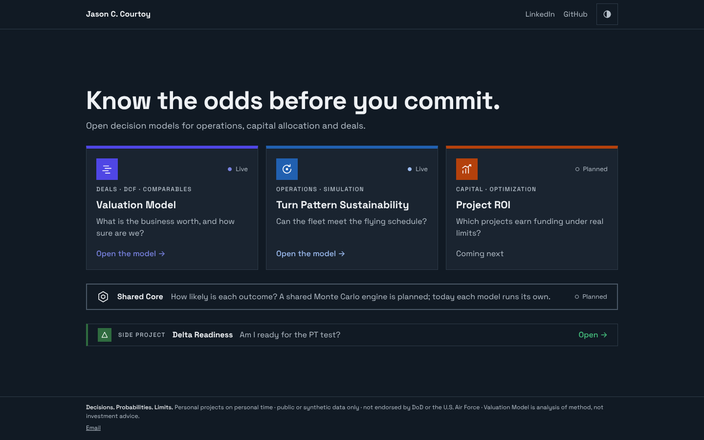
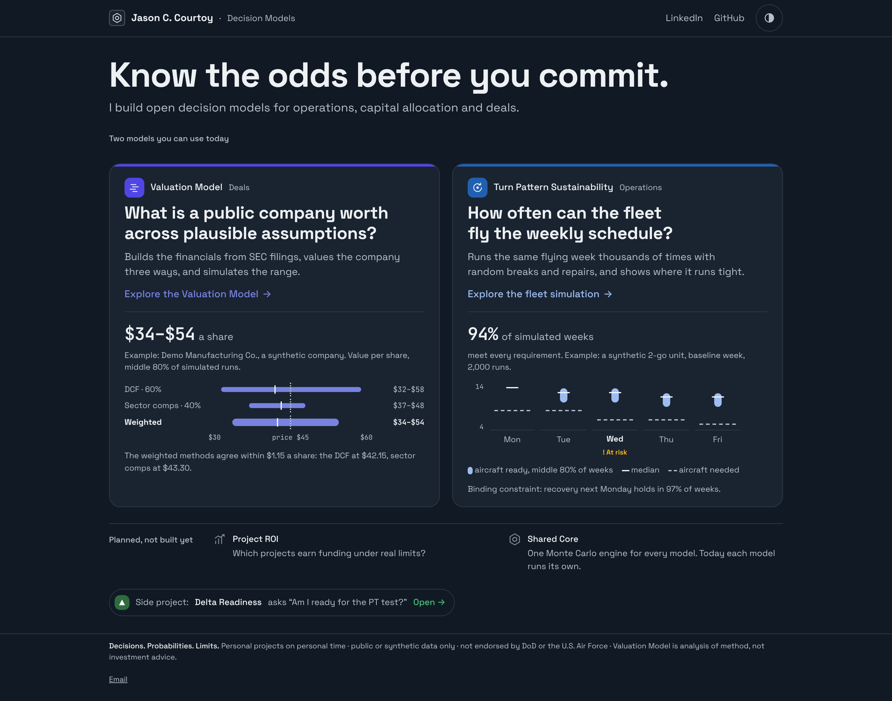
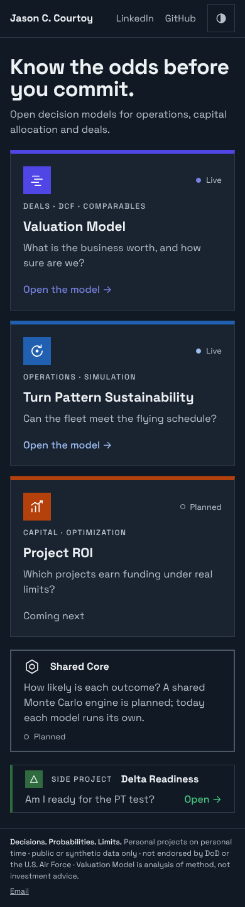
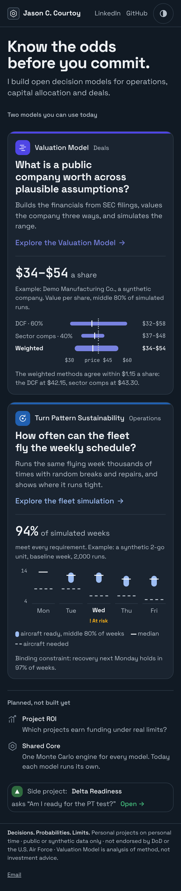

# Homepage redesign: design review (2026-11-19)

**Recommendation: question-led columns.** Each live model gets one column, side by side on desktop and stacked on a phone. The model's decision question is the link, and a small example result, read from the JSON the model already publishes, sits directly under it. Planned work moves to a quieter "Planned, not built yet" list, and Delta Readiness keeps its own side-project line.

It won because it is the only option tested that puts both decision questions, both calls to action and both example answers inside the first 1280×800 screen while keeping the questions, not the badges or boxes, as the strongest element after the headline.

| | Before | After |
|---|---|---|
| Desktop, dark |  |  |
| Phone, dark |  |  |

Light mode: [desktop](after-desktop-light.png), [phone](after-phone-light.png). Keyboard focus: [after-keyboard-focus.png](after-keyboard-focus.png). First screen at 1280×800: [after-1280x800-first-screen.png](after-1280x800-first-screen.png).

## What I found on the current page

How I looked: the repository at `main` (`086e103`, PR #19 merged and deployed by the Pages run at 15:12Z) rendered locally in Chromium, with both models served from their own exports (TPS `export_site.py`; Valuation `site/` plus its published `site-data` branch and the demo built by `write_demo`). This container can't open `*.github.io`, so the live pages were read through a fetch tool. That tool returned an older copy that still had Research & Analysis, so I couldn't confirm the deployed copy directly. The Pages run record says `086e103` is live.

1. **Eye order today.** First the headline. Second the row of three equal cards, read as one block, with nothing that says which card to pick. Third the Shared Core band, whose 2 px outline is heavier than the model cards around it. *(Browser observation and design judgment.)*
2. **What gives the portfolio its identity.** Space Grotesk, the dark navy page, square icon tiles in each model's brand fill, the thick color rule that also starts each app's header, and the tagline. These carry through into the apps, so a visitor feels the click-through as the same product. *(Design judgment.)*
3. **Where the hierarchy hurts the choice.** The planned Project ROI card has the same size, color and weight as the two live models. The only difference is a 13 px "Planned" pill. The questions are secondary gray text, while the most prominent link text, "Open the model", is the same on both cards. Nothing shows what each tool gives back (a dollar range compared with the share of weeks the schedule holds). *(Design judgment. Whether visitors actually hesitate would need testing with real visitors.)*
4. **The one change that helps the choice most.** Show the two live models alone, each led by its question and an example of its answer, and move planned work out of the same row. *(Design judgment.)*

## The proposal, choice by choice

| Proposal | Kept / changed | Why |
|---|---|---|
| Warm paper `#F7F6F2`, ink, teal accent | **Not used.** Brand tokens kept (dark primary, `#F7F8FA` light). | Every app uses the brand surfaces. A warm paper hub would make each click-through feel like a different site. Teal would add a sixth hue. It sits near the TPS teal in the brand guide and the Delta green, and it doesn't stand for any model. Focus and shared links use ink instead, which passes contrast in both themes without a new color. |
| Model colors on their own marks, graphics and links | **Kept.** | Each column's top rule, tile, chart series and link use only that model's colors. |
| Source Serif 4 headline vs all-sans | **All-sans, Space Grotesk.** | I rendered all three at 1280 and 390 px. The serif looks good but reads like a publication, and the apps never use it. Inter is generic. Space Grotesk's `y` and `g` already give the headline character. One line on desktop, two balanced lines on a phone ("Know the odds / before you commit."), at about 56 px and 34 px. No new font requests. |
| "Know the odds before you commit." + one sentence in my voice | **Kept.** "I build open decision models for operations, capital allocation and deals." | It is the brand line in the first person, and it doesn't conflict with the military role. |
| Core mark + name + quiet "Decision Models" label | **Kept.** | The label is hidden on phones so the top bar stays on one line at 390 px. |
| Two wide panels, side by side | **Kept, as rounded panels** (changed 2026-11-19 at Jason's request). | The first version used open columns with a 3 px top rule. Jason asked for rounded shapes, so the live models are now soft panels (18 px radius, 4 px brand-color cap) with rounded tiles, bars, theme toggle and focus rings. Only two panels, each a different color and with its own chart, so they don't read as a stack of identical boxes. Homepage only: the app pages keep their square frame. |
| "Live" / "Planned" badges | **Replaced by section labels.** | "Two models you can use today" and "Planned, not built yet" carry status as text. Planned items have no link, no color fill and a muted outline mark, so they can't be mistaken for tools. |
| Questions | **Valuation reworded, TPS adapted.** | Valuation: "What is a public company worth across plausible assumptions?" It values US-listed companies from SEC filings, so "public company" sets the right expectation. TPS: "How often can the fleet fly the weekly schedule?" It reports the share of simulated weeks that meet every requirement. |
| Chart previews | **Kept, but drawn from engine output.** | Valuation shows a football field of the weighted methods for the synthetic demo company, with the share price marked. TPS shows aircraft ready against aircraft needed, Monday to Friday, for the default synthetic preset. Both are labeled as examples, give units, and add a one-line takeaway from the model's own text. |
| Shared Core on the homepage | **Kept, demoted to one line** in "Planned, not built yet". | It is still the story of the suite (one engine), but it is not a tool. |

## Two options, same content

| | A: proposal (two boxed panels, warm paper, serif, teal) | B: question-led (this PR) |
|---|---|---|
| Preview | [desktop light](option-a-proposal-desktop-light.png), [desktop dark](option-a-proposal-desktop-dark.png), [phone](option-a-proposal-phone-light.png) | [desktop](after-desktop-dark.png), [phone](after-phone-dark.png) |
| Real strength | Looks fresh and editorial. The boxed panels make the two tools read clearly as a pair. | The question is the biggest thing in each column and is the link itself. It matches the apps, so the click-through feels like the same product. |
| Real weakness | It breaks visual continuity with every app, and the "Live" badges and boxes add chrome without adding information. | Quieter on first impression than A. It depends on the preview JSON loading, and when it doesn't, the column falls back to a single line. |
| Maintenance | A second palette and font to keep in sync | Brand tokens only, plus one small script with a CI contract check |

I tried B first as full-width rows, one per model. At 1280×800 the second model's preview fell below the fold, so I took A's side-by-side composition and kept B's question-led content and open styling.

## Checks run

- **Chromium 157 (Playwright 1.63, headless)** at 1440×900, 1280×800, 640 (equal to 200% zoom at 1280), 390, 360 and 320 px wide, in both color schemes. No horizontal overflow at any width. WebKit and Firefox are not installed here, so **Safari/iPhone rendering was not tested.** The 390 px checks are a Chromium emulation.
- **Headings:** h1 → h2 "Two models you can use today" → h3 per question → h2 "Planned, not built yet".
- **Link names:** "What is a public company worth across plausible assumptions? Explore the Valuation Model", "How often can the fleet fly the weekly schedule? Explore the fleet simulation", and the Delta line reads as one sentence. The whole column is clickable, and there is one tab stop per model.
- **Keyboard:** tab order is name → LinkedIn → GitHub → theme → Valuation → TPS → Delta → Email. Each stop shows a 2 px ink outline, 3–4 px offset.
- **Tap targets:** every control is at least 44 px tall except the footer Email link (42 px, above the 24 px minimum).
- **Contrast (computed):** all text is at least 4.5:1 in both themes. The smallest chart labels (11 px) are 9.5:1 dark and 6.9:1 light. Series are told apart by shape as well as color: bar = middle 80%, tick = median, dashed = needed or price, and "! At risk" as text.
- **Chart alternatives:** each chart is `role="img"` with an aria-label listing every value it draws.
- **Fallback:** with the model data blocked, both previews show one line ("The example preview didn't load…") and the links still work.
- **Reduced motion:** the arrow nudge on hover is off.
- **Click-through:** TPS lands on its Overview, which shows the same 94% headline for the same synthetic preset. Valuation lands on the live mode (Apple, real SEC data) with a value range per share, which matches the question. The homepage preview uses the synthetic demo company and says so.
- `pytest -q tests`: 13 passed. `python scripts/check_previews.py --fixtures tests/fixtures/previews` passes. The `Checks` workflow now also runs the live preview check weekly.

## Limitations and follow-ups

- **One-screen rule:** at 1280×800 both questions, links and example answers fit, but the TPS legend, the planned list, Delta and the footer need a short scroll (page height 1,132 px). The brand guide's 2026-10-11 rule says no scrolling. This needs your call (see BACKLOG item 4).
- **Valuation first visit:** a new visitor lands on Apple with a "Build warnings: interest not tagged…" banner above the headline. That is not a good first impression from a recruiter's click. It belongs to the valuation repo, so it is outside this pass.
- **Brand guide drift:** the brand guide lists TPS as teal `#0F766E`, but `brand.css` ships blue `#2160B0`. Valuation indigo and TPS blue sit close together. The tiles and labels keep them apart here, but the palette is worth a look.
- **Not tested with real visitors.** The "can a visitor tell what Jason builds and pick the right tool" test is my design judgment from the rendered page.
